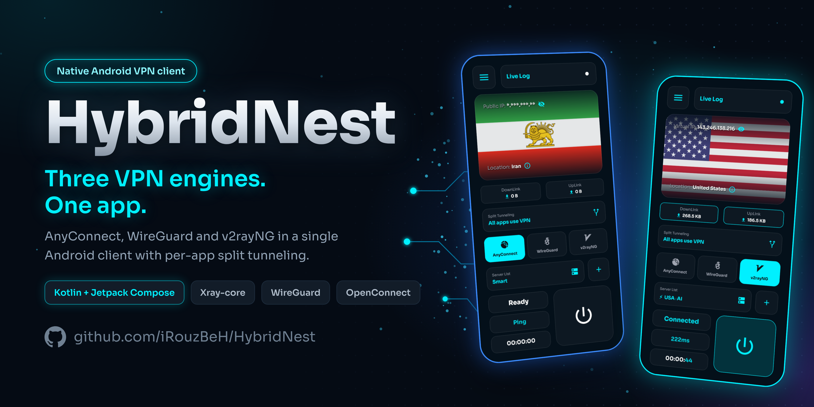

# HybridNest

<p align="center">
  
</p>

<p align="center">
  <a href="https://github.com/iRouzBeH/HybridNest/releases/latest"></a>
  
  
  
  <a href="LICENSE"></a>
</p>

**HybridNest** is an advanced Android VPN client built with Kotlin and Jetpack Compose that unifies Cisco AnyConnect, WireGuard, and v2rayNG into a single fluid application. It delivers high-performance multi-protocol tunneling with zero root requirements, fail-closed split tunneling, and 16KB page-size alignment for Android 15+.

---

## Supported Engines

| Engine | Core | Highlights |
|:---|:---|:---|
| **Cisco AnyConnect** | Native `libopenconnect` (C/JNI) | Dual SSL/TLS (`CSTP`) + UDP (`DTLS`), XML form auth, configurable MTU & DPD |
| **WireGuard** | User-space gVisor Netstack | Zero root required, `.conf` / `.zip` / QR / URI import, Curve25519 keygen, DNS bootstrap pinning |
| **v2rayNG** | Embedded `Xray-core` | VLESS, VMess, Trojan, Reality, XHTTP/SplitHTTP, WebSocket, gRPC, MUX & custom routing |

---

## Key Features

- **Per-App Split Tunneling:** Fail-closed Allow and Bypass modes with instant search, quick filters (*All* / *Selected* / *System*), and crisp high-DPI app icons.
- **Seamless Switching & Persistence:** Remembers the last active server per protocol and custom `v2rayNG` tab order; switch servers within the same protocol while connected without manual disconnection.
- **Subscriptions & Latency Testing:** Batch and single-server latency tests with instant cancellation, plus full-screen locking feedback during subscription updates.
- **Domain Bypass:** Built-in `.ir` domain bypass enabled by default (fully editable or removable) alongside custom domain routing rules in Xray-core.
- **Hotspot & LAN Sharing (No Root):** Built-in HTTP and SOCKS5 local proxy relay with automatic hotspot/Wi-Fi interface IP detection for PCs, consoles, and TVs.
- **Accurate IP & Update Checks:** Parallel multi-provider HTTPS GeoIP consensus and on-demand GitHub Releases update checking directly inside the app.
- **Backup, Restore & Live Logs:** Full JSON profile backup and restore via clipboard, paired with categorized live diagnostic logs.

---

## Download

Get the latest signed APKs directly from [GitHub Releases](https://github.com/iRouzBeH/HybridNest/releases/latest):

| APK File | Target Architecture | Description |
|:---|:---:|:---|
| **`HybridNest-v1.1-arm64-v8a.apk`** | `arm64-v8a` | **Recommended (Modern Phones):** 64-bit ARM devices (95%+ of modern Android phones). Smallest download and best performance. |
| **`HybridNest-v1.1-armeabi-v7a.apk`** | `armeabi-v7a` | **Older / 32-bit Phones:** 32-bit ARM smartphones, legacy budget tablets, and 32-bit Android TV boxes. |
| **`HybridNest-v1.1-universal.apk`** | Universal | **All ARM Devices:** Multi-ABI package containing both 32-bit and 64-bit binaries. |

> [!TIP]
> Download `SHA256SUMS.txt` from the release assets to verify the cryptographic checksum of your downloaded APK.

---

## Privacy & Security

- **No Tracking:** Zero analytics, telemetry, or advertising SDKs. Google ML Kit is used strictly on-device for QR scanning; update checks only query GitHub Releases when you explicitly open *Check for Update*.
- **Log Redaction:** Passwords, tokens, and private keys are masked in live logs by default (can be turned off in Settings if needed for debugging).
- **Local Storage:** Profiles and credentials are stored locally in plaintext inside the app's private Android sandbox with cloud backup and device transfer disabled (`allowBackup="false"`).
- **Clipboard Export:** Exporting profiles copies plaintext JSON to your clipboard after a confirmation warning (marked as sensitive on Android 13+).

---

<details>
<summary><strong>Build from Source</strong></summary>

<br>

### Prerequisites
- **JDK 17 or 21**
- **Android SDK** (API 36/37)
- **Android NDK** (`26.3.11579264`)
- **CMake** (`3.22.1+`)

### Build Commands
```bash
# 1. Clone repository
git clone https://github.com/iRouzBeH/HybridNest.git
cd HybridNest

# 2. Run unit tests
./gradlew testDebugUnitTest

# 3. Assemble release APKs (requires keystore.properties configured)
./gradlew assembleRelease
```
Outputs will be in `app/build/outputs/apk/release/`.
</details>

---

## License

HybridNest is licensed under the [GNU General Public License v3.0](LICENSE).
